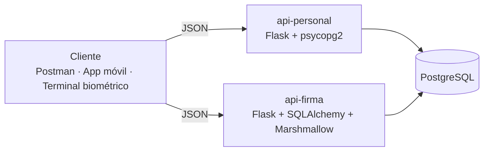
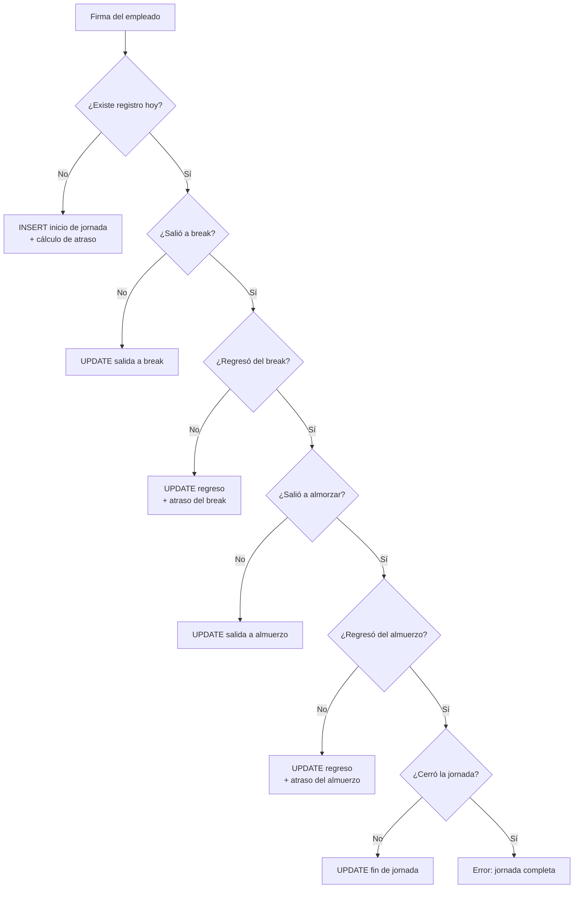
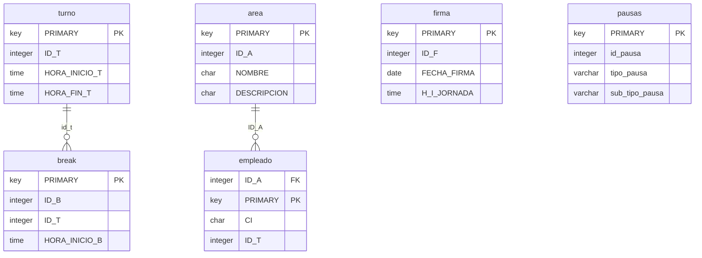

<div align="center">

# 👥 APIs de Talento Humano

### Microservicios REST para la gestión de personal y el control de asistencia (reloj de firmas) de una empresa de call center

[](https://www.python.org/)
[](https://flask.palletsprojects.com/)
[](https://www.postgresql.org/)
[](https://www.sqlalchemy.org/)
[](#-pruebas)
[](#-endpoints)

</div>

---

## 📖 Descripción

Este repositorio contiene **dos servicios REST independientes** que comparten la misma base de datos PostgreSQL:

| Servicio | Puerto | Responsabilidad |
|---|---|---|
| [`api-personal`](api-personal) | `5000` | CRUD y búsqueda de empleados (datos personales, área, turno, recesos) |
| [`api-firma`](api-firma) | `5001` | Registro de asistencia: inicio de jornada, breaks, almuerzo y salida, con **cálculo automático de atrasos** |

El servicio de firmas resuelve un problema real de las empresas con turnos: el empleado **siempre llama al mismo endpoint** y el sistema deduce qué evento del día le corresponde registrar.

## 🏗️ Arquitectura



- **api-personal:** Flask con *Blueprints*, capa de acceso a datos con `psycopg2`, CORS habilitado y listo para producción con `gunicorn`.
- **api-firma:** patrón *Application Factory*, modelos **SQLAlchemy**, validación y serialización con **Marshmallow**, driver `pg8000` (Python puro) y migraciones con Flask-Migrate.
- Configuración por variables de entorno (`.env`), sin credenciales en el código.

## ⚙️ Lógica del reloj de firmas

`POST /api/firmas/procesar` aplica una **verificación en cascada** sobre el registro del día:



Los atrasos se calculan contra el **turno** y el **receso** asignados al empleado. Un endpoint adicional **autocompleta** las firmas incompletas al cierre del día.

## 🔌 Endpoints

**api-personal** · `http://localhost:5000/api`

| Método | Ruta | Descripción |
|---|---|---|
| GET | `/personal` | Listar empleados |
| GET | `/personal/<ci>` | Obtener empleado por cédula |
| GET | `/personal/search?nombres=&apellidos=` | Búsqueda por nombre o apellido |
| POST | `/personal` | Crear empleado |
| PUT | `/personal/<ci>` | Actualizar empleado |
| DELETE | `/personal/<ci>` | Eliminar empleado |

**api-firma** · `http://localhost:5001/api`

| Método | Ruta | Descripción |
|---|---|---|
| POST | `/firmas/procesar` | ⭐ Registra el siguiente evento del día automáticamente |
| POST | `/firmas/iniciar-jornada` | Inicio de jornada explícito |
| GET | `/firmas` · `/firmas/<id>` | Listar / obtener firmas |
| GET | `/firmas/empleado/<ci>` | Historial de un empleado |
| GET | `/firmas/empleado/<ci>/fecha/<fecha>` | Firma de un empleado en una fecha |
| GET | `/firmas/fecha/<fecha>` · `/firmas/hoy` | Firmas por día |
| GET | `/firmas/incompletas` | Jornadas sin cerrar |
| PUT | `/firmas/autocompletar` | Completa firmas pendientes |
| PUT · DELETE | `/firmas/<id>` | Corregir o eliminar una firma |
| GET | `/health` | Estado del servicio |

Documentación detallada: [`docs/api-firma-endpoints.md`](docs/api-firma-endpoints.md)

## 🗄️ Modelo de datos



> La base incluida en `database/talento_humano_demo.sql` contiene **datos ficticios** de demostración.

## 🚀 Ejecución local

```bash
# 1. Base de datos
createdb talento_humano
psql -d talento_humano -f database/talento_humano_demo.sql

# 2. API de personal
cd api-personal
python -m venv venv && source venv/bin/activate   # en Windows: venv\Scripts\activate
pip install -r requirements.txt
cp .env.example .env                               # completar credenciales
python run.py                                      # http://localhost:5000

# 3. API de firmas (en otra terminal)
cd api-firma
python -m venv venv && source venv/bin/activate
pip install -r requirements.txt
cp .env.example .env
python run.py                                      # http://localhost:5001
```

## 🧪 Pruebas

- Colecciones **Postman** listas para importar en cada servicio.
- Pruebas automatizadas de endpoints en `api-personal/tests/`.
- Guía de pruebas paso a paso de un día laboral completo: [`docs/api-firma-guia-pruebas.md`](docs/api-firma-guia-pruebas.md).

## 👤 Autor

**Marco Adrián Padilla Triviño** · Estudiante de Ingeniería de Software, Universidad de las Fuerzas Armadas ESPE

[](https://github.com/Adrizzx)
